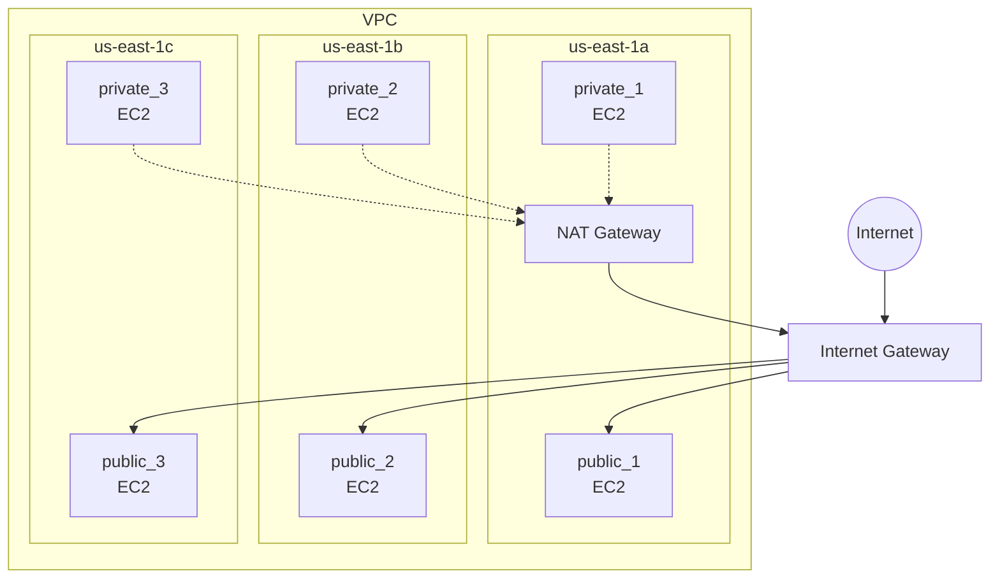
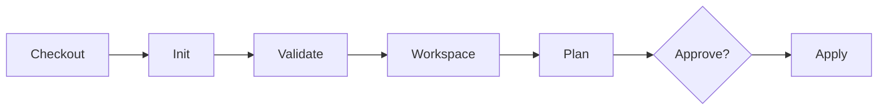

<div align="center">

# ☁️ Terraform AWS Multi-Environment with Jenkins

**Multi-AZ VPC + EC2 + S3 on AWS, deployed to dev / preprod / prod through a Jenkins pipeline with manual approval.**

[](LICENSE)


</div>

Runs against a **local AWS emulator** (Floci on port `4566`), so it costs nothing to test.

## 📑 Table of Contents

- [Architecture](#-architecture)
- [What it creates](#-what-it-creates)
- [Environments](#-environments)
- [Jenkins pipeline](#-jenkins-pipeline)
- [Getting started](#-getting-started)
- [Project structure](#-project-structure)
- [Using real AWS](#-using-real-aws)
- [Troubleshooting](#-troubleshooting)
- [What I learned](#-what-i-learned)
- [Author](#-author)

## 🏗️ Architecture



## 📦 What it creates

Everything below is created **per environment**:

| Resource | Details |
| --- | --- |
| 🌐 **VPC** | CIDR set by `vpc_cidr`, DNS support and hostnames enabled |
| 🧩 **Subnets** | 3 public + 3 private, one pair per availability zone |
| 🚪 **Internet Gateway** | Public internet access |
| 🔁 **NAT Gateway** | In the first public subnet, with an Elastic IP |
| 🛣️ **Route tables** | Public (to IGW) and private (to NAT), with associations |
| 🔒 **Security group** | Ingress port and protocol set by variables, all egress allowed |
| 🖥️ **EC2** | 6 instances: 3 public and 3 private, one per subnet |
| 🪣 **S3 bucket** | `<env>-demo-bucket` |

## 🌍 Environments

Each environment has its own tfvars file and its own Terraform **workspace**, so state is kept separate.

| Environment | tfvars file | VPC CIDR |
| --- | --- | --- |
| `dev` | `dev.tfvars` | `10.0.0.0/16` |
| `preprod` | `preprod.tfvars` | `172.16.0.0/16` |
| `prod` | `prod.tfvars` | `192.168.0.0/16` |

## 🚀 Jenkins pipeline

The pipeline takes an `ENV` parameter (`dev`, `preprod` or `prod`).



| # | Stage | What it does |
| --- | --- | --- |
| 1 | **Checkout** | Pulls the repository |
| 2 | **Terraform Init** | Downloads providers |
| 3 | **Validate** | Checks the configuration |
| 4 | **Workspace Select** | Selects the workspace, creates it if missing |
| 5 | **Plan** | Runs `plan` with `<env>.tfvars` and saves it to `tfplan` |
| 6 | **Approve** | Manual approval, times out after 10 minutes |
| 7 | **Apply** | Applies the saved plan |

### 📧 Failure notifications

If the build fails, an email is sent with the job name, build number, environment and a link to the logs.

1. Configure SMTP in Jenkins (**Manage Jenkins > System > E-mail Notification**).
2. Add a `NOTIFY_EMAIL` environment variable (**Manage Jenkins > System > Global properties**) with the address to notify.

> The address is not stored in the repository on purpose.

## ⚡ Getting started

### Prerequisites

- Terraform `>= 1.0`
- Local AWS emulator running on port `4566`
- Jenkins with Terraform installed on the agent (for the pipeline)

### Run locally

```bash
git clone https://github.com/mennamedhat11/Day-3.git
cd Day-3

terraform init
terraform workspace select dev || terraform workspace new dev
terraform plan  -var-file=dev.tfvars
terraform apply -var-file=dev.tfvars
```

The provider endpoint defaults to `http://host.docker.internal:4566`, which works from inside a Jenkins container. When running Terraform directly on your machine, override it:

```bash
terraform plan -var-file=dev.tfvars -var="endpoint=http://localhost:4566"
```

### Clean up

```bash
terraform destroy -var-file=dev.tfvars
```

## 🗂️ Project structure

```
.
├── provider.tf       # AWS provider (local emulator)
├── var.tf            # Input variables
├── vpcs.tf           # VPC
├── subnets.tf        # Public and private subnets
├── igw.tf            # Internet Gateway
├── nat.tf            # Elastic IP + NAT Gateway
├── route_table.tf    # Route tables and associations
├── SG.tf             # Security group and rules
├── EC2.tf            # EC2 instances
├── s3.tf             # S3 bucket
├── dev.tfvars        # dev values
├── preprod.tfvars    # preprod values
├── prod.tfvars       # prod values
├── Jenkinsfile       # CI/CD pipeline
└── LICENSE
```

## 💳 Using real AWS

Remove the `access_key`, `secret_key`, `skip_*`, `s3_use_path_style` and `endpoints` settings from `provider.tf`, then configure real credentials with `aws configure`.

> ⚠️ NAT Gateway and EC2 are **billable** on real AWS.

## 🛠️ Troubleshooting

<details>
<summary><b>Terraform cannot connect to the endpoint</b></summary>

Make sure the emulator is running on port `4566`. From the host use `-var="endpoint=http://localhost:4566"`. From a Jenkins container use the default `host.docker.internal`.

</details>

<details>
<summary><b>Pipeline cannot find the tfvars file</b></summary>

The file name must match the `ENV` parameter: `dev.tfvars`, `preprod.tfvars` or `prod.tfvars`.

</details>

<details>
<summary><b>No failure email</b></summary>

Check the SMTP settings in Jenkins and that `NOTIFY_EMAIL` is set.

</details>

<details>
<summary><b>State disappears between builds</b></summary>

State is stored in the Jenkins workspace. If the workspace is cleaned, the state is lost. A remote backend solves this.

</details>

## 🎓 What I learned

- Designing a multi-AZ VPC with public and private tiers
- Routing with an Internet Gateway and a NAT Gateway
- Managing multiple environments with workspaces and tfvars files
- Automating plan, approval and apply with a Jenkins pipeline
- Testing Terraform locally against an AWS emulator

## 👩‍💻 Author

**Menna Medhat Hassan**

[](https://github.com/mennamedhat11)

## 📄 License

Licensed under the MIT License. See [LICENSE](LICENSE).
